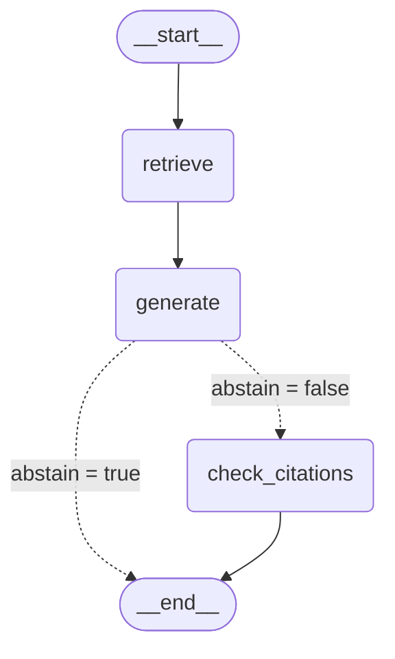

# M5 LangChain/LangGraph 통합

#65의 검색·생성 코어(프레임워크 없는 함수·CLI)를 그대로 두고, 그 위에 LangChain `BaseRetriever`와 LangGraph 상태 그래프를
얹은 어댑터다. 같은 입력에서 코어 경로와 결과가 같음을 테스트와 실제 Ollama 10문항으로 보인다. 이 프로젝트는 Bkankim의
단독 프로젝트다.

- 코드: `src/krsec_rag_lab/integrations/{langchain_adapter,langgraph_pipeline}.py`, CLI `scripts/run_langgraph.py`,
  테스트 `tests/test_integrations.py`
- 의존성: `pyproject.toml`의 새 그룹 `langchain`(`langchain-core>=1.7,<2`, `langgraph>=1.2,<2`). lock 해상도는 langchain-core
  1.7.3, langgraph 1.2.18이다. 기존 그룹(dev·embed·qdrant)과 기존 패키지 버전은 그대로이고 `uv.lock`은 추가만 있다.
- 코어 정의의 정본은 `docs/m5-generation.md`다. 이 문서는 어댑터가 코어를 어떻게 부르는지와 동등성 결과만 적는다.

## 설계: 코어 함수 유지, 어댑터만

| 원칙 | 구현 |
|---|---|
| 코어 모듈을 고치지 않는다 | `generation/`, `baselines/`는 변경이 없다. 어댑터는 공개 함수만 import해 부른다 |
| 프레임워크는 `integrations/` 안에서만 import한다 | `integrations/__init__.py`는 아무것도 import하지 않는다. 테스트가 `src/` 전체에서 `langchain`·`langgraph` import 위치를 검사한다 |
| CI(dev 그룹)에서 깨지지 않는다 | `tests/test_integrations.py`는 맨 위에서 `pytest.importorskip("langchain_core")`·`("langgraph")`를 한다. 그룹이 없으면 파일 전체가 skip이고 코어 테스트는 그대로 돈다 |
| 순위·문맥·프롬프트·재질의 규칙을 새로 만들지 않는다 | 그래프 노드는 `retrieve`, `build_context`, `generate`(내부에서 `build_prompt`·LLM·`parse_answer`·재질의 1회)를 그대로 부른다 |
| LLM은 코어와 같은 방식으로 넘긴다 | `build_graph(index, llm)`의 `llm`은 `llm(messages) -> LLMResponse` 호출 가능 객체다(실행 = `OllamaLLM`, 테스트 = 가짜 LLM) |

### `BM25CoreRetriever` (`langchain_adapter.py`)

`BaseRetriever` 하위 클래스. 필드 `index`(`GenerationIndex`)와 `k`(기본 3). `_get_relevant_documents`가 코어
`retrieve(index, query, k)`를 그대로 부르고 결과를 `Document`로 옮긴다.

| `Document` 칸 | 값 |
|---|---|
| `page_content` | 색인 텍스트(`index.text(doc_id)`, 공개 = `"{id} {description_en}"`). 문서당 문자 상한은 걸지 않는다(상한은 문맥 구성 `build_context`의 일이다) |
| `metadata["doc_id"]`, `Document.id` | 문서 ID |
| `metadata["score"]` | BM25 점수(코어가 돌려준 값 그대로) |
| `metadata["rank"]` | 1부터 시작하는 순위 |

순위 규칙(`(-점수, 문서 ID)` 정렬, 동점은 문서 ID 순, 일치 토큰이 없으면 0건)은 코어가 정하고 어댑터는 바꾸지 않는다.

### `build_graph` (`langgraph_pipeline.py`)



(위 그림은 `build_graph(...).get_graph().draw_mermaid()` 출력에 분기 조건 라벨만 더한 것이다.)

| 노드 | 부르는 코어 함수 | 상태에 넣는 것 |
|---|---|---|
| `retrieve` | `retrieve(index, question, k)` -> `build_context(track, doc_ids, index.text)` | `retrieved`(`[문서 ID, 점수]`), `context_text`, `truncated` |
| `generate` | `generate(question, context_text, allowed_ids, llm)` (LLM 호출 + `parse_answer` + 재질의 1회) | `answer`, `abstain`, `citations`, `n_invalid_citations`, `status`, `n_attempts`, `prompt_tokens`, `completion_tokens`, `latency_ms` |
| `check_citations` | `parse_answer` | `citation_check` = `{ok, n_citations, n_outside_context}` |

- 분기: `generate`가 돌려준 `abstain`으로 정한다. 기권이면 종료(`citation_check` 칸 없음), 아니면 `check_citations`. 파싱 실패와
  `context_overflow`는 `abstain=false`이므로 검사 노드를 지난다(인용이 비어 있어 검사는 통과한다).
- 인용 검사 노드는 결과를 바꾸지 않는다. 현재 `answer`·`abstain`·`citations`를 계약 JSON으로 다시 만들어 코어 `parse_answer`에
  통과시키고, 인용이 문맥 ID 안의 중복 없는 문자열인지만 `citation_check`에 적는다. gold 여부는 보지 않는다. 문맥 밖 인용은
  `generate` 안의 `parse_answer`가 이미 걸러 `n_invalid_citations`로 세었으므로 이 노드가 보는 `citations`는 걸러진 뒤의 값이다.
- `state_to_row`·`run_graph_question`은 최종 상태를 코어 `run_question`과 같은 키의 결과 행으로 바꾼다(동등성 비교용).

## 재현

```sh
uv sync --locked --group langchain                          # langchain-core·langgraph
uv run --no-sync pytest -q tests/test_integrations.py       # skip 없이 통과해야 한다
ollama serve                                                # 별도 프로세스. 이미 떠 있으면 그것을 쓰고, 띄웠다면 그 프로세스만 끈다
uv run --no-sync python scripts/run_langgraph.py --compare --n 10                 # 커밋된 public_k3.jsonl과 대조
uv run --no-sync python scripts/run_langgraph.py --question "<질문>" --k 3        # 질문 하나(최종 상태 JSON)
uv run --no-sync python scripts/run_langgraph.py --split test --limit 10 --k 3    # 질의셋(코어 결과 행과 같은 키의 JSONL)
uv sync --locked --dev                                      # 끝나면 dev 그룹으로 되돌린다
```

`scripts/run_langgraph.py`는 공개(NVD) 트랙만 돌린다. KISA 트랙은 그래프로 돌리지 않는다(`LICENSES/README.md`: 생성 답변과
문맥은 공지 본문을 옮길 수 있다). 결과는 표준 출력에만 쓰고 커밋 산출물을 만들지 않는다. 그룹이 없으면 안내 문구와 함께
exit 1이다.

## 동등성

### 테스트 (`tests/test_integrations.py`, 모델·네트워크 없음)

가짜 LLM은 받은 문맥에 따라 응답한다(문맥 첫 문서 ID를 인용하고, 문맥이 비면 기권). 합성 색인에서 질의 5종 x k(1, 3, 5) x LLM
동작 5종 = 75칸마다, 코어 `run_question` 경로와 그래프 경로가 서로 다른 가짜 LLM 인스턴스로 돌아 아래가 모두 같음을 확인한다.

| 비교 | 내용 |
|---|---|
| 검색 결과 | 순서·문서 ID·점수 (`retrieve`와 그래프 상태의 `retrieved`) |
| LLM에 넘긴 입력 | 호출마다의 메시지 목록 전체(재질의 메시지 포함) |
| 출력 필드 | `abstain`, `citations`, `answer` |
| 결과 행 | `run_question`이 만든 행 전체(상태·토큰·문맥 해시·시도 횟수 포함)와 `run_graph_question`의 행 |

- 질의 5종: 일치 1건(`single`), 동점 3건(`tie`: 본문이 같은 문서 3개 -> 점수가 같고 문서 ID 순), 동점 + 더 높은 점수
  (`tie_and_more`), 검색 0건(`zero_hits`: 빈 문맥 문구가 LLM에 가고 기권), k보다 많은 일치(`many_hits`).
- LLM 동작 5종: 문맥 첫 문서 인용, 첫 응답이 JSON 아님 -> 재질의에서 인용, 두 번 모두 파싱 실패, 문맥 밖 ID 인용, 항상 기권.
- 커밋된 공개 질의셋·코퍼스(1560건)로 만든 실제 색인에서 유형을 돌려 고른 12문항 x k(1, 3, 5)도 같은 비교를 한다.
- 어댑터: `BM25CoreRetriever`의 문서 ID·순서·점수·`page_content`가 `retrieve`와 같고(동점·0건 포함), 그래프의 `retrieved`와 같은
  문서를 본다.
- 분기: 기권이면 `citation_check`가 없고, 답이면 있으며 결과가 코어와 같다. 그래프 모양(노드와 조건부 간선)도 확인한다.
- 재현성: 커밋된 manifest의 `run_id`가 현재 코드의 `run_config`로 다시 만들어지고, 모델 digest·가중치 해시·요청 옵션이 하나라도
  다르면 `GateFailure`다.
- `--compare` 전체 경로: 저장된 답을 그대로 돌려주는 가짜 LLM으로 돌리면 10문항 모두 일치하고 문맥 해시(`context_sha256`)와
  검색 목록도 저장본과 같다. 다른 답을 주면 불일치 목록과 exit 1이다.

### 실제 Ollama 10문항

| 항목 | 값 |
|---|---|
| 기준 결과 | `results/m5/generation/public_k3.jsonl` (#65, 기준 커밋 = main `504200e`) |
| 질문 | `split == test`인 행을 파일 순서로 앞 10개, k = 3 |
| 모델·옵션·프롬프트 | `manifest.json`의 `run_id` `8a7c1c6b2f8bf06b`와 같다(모델 `qwen3:8b`, digest `500a1f067a9f…`, `temperature 0`, `seed 42`, `num_ctx 16384`, `num_predict 512`, `think false`, `format json`). `--compare`가 실행 전에 `prompt_fingerprint()`(= manifest의 `prompt.sha256` `48c60b10…`)와 `run_id`를 대조하고, 다르면 멈춘다 |
| 비교 필드 | `abstain`, `citations`, `answer` 정확 일치(참고로 `context_sha256`·`retrieved`도 대조) |
| Ollama | 서버 0.32.15, 이 맥(Apple M5 Pro)에서 `ollama serve`를 직접 띄워 실행하고 실행 뒤 그 프로세스만 껐다 |

질문 ID: `pub-cve-0001`, `pub-cve-0002`, `pub-cve-0004`, `pub-cve-0006`, `pub-cve-0007`, `pub-cve-0009`, `pub-cve-0010`,
`pub-cve-0012`, `pub-cve-0014`, `pub-cve-0015` (전부 `cve_explicit`, 검색 1건, 기권 없음).

결과: **10/10 일치** (`abstain`·`citations`·`answer` 모두 같고, 10문항 모두 `context_sha256`·`retrieved`도 같았다). 불일치 질문은 없다.

## 한계

- 일치 10문항은 전부 `cve_explicit`이다. 질문을 "test 파일 순서 앞 10개"로 고정한 규칙의 결과라 `product_symptom`·`no_answer`와
  기권 경로, 재질의 경로는 실제 모델로 비교하지 않았다. 이 경로들은 가짜 LLM 동등성 테스트(위 75칸과 실제 질의셋 12문항)로만 본다.
- 10문항 x 모델 하나 x 시드 하나의 비교다. "온도 0이면 같다"를 일반적으로 보장하지 않는다(다른 하드웨어·Ollama 버전에서의 재현은
  `docs/m5-generation.md`의 결정성 항목과 같은 한계).
- 그래프는 코어 파이프라인의 얇은 포장이라 더 좋은 답을 만들지 않는다. 인용 검사 노드는 형식만 다시 확인하고 결과를 바꾸지
  않는다(gold 여부도 보지 않는다).
- `BM25CoreRetriever`는 BM25 하나만 감싼다. 하이브리드·리랭크 등 다른 검색기와 LangChain 체인·에이전트·도구 호출은 범위 밖이다.
- 외부 추적(LangSmith)은 쓰지 않는다. `LANGSMITH_TRACING`·`LANGCHAIN_TRACING_V2` 등이 환경에 켜져 있어도 `invoke_graph`·
  `run_graph_question`은 `langsmith.tracing_context(enabled=False)`로 추적을 끈 채 돌려 노드 입출력(문맥·답변)이 올라가지 않는다.
  `graph.invoke`를 직접 부르면 추적이 켜진 환경에서 첫 노드가 고정 오류 `tracing_env_refused`로 거부한다(문맥을 만들기 전, LLM 호출 전).
  다만 그 직접 호출은 거부 전에 질문 문자열과 k를 담은 최상위 실행 기록이 추적기로 갈 수 있다. 직접 호출 대신 `invoke_graph`를 쓴다.
- CLI는 공개 트랙만 지원한다. KISA 트랙을 그래프로 돌린 답변·문맥은 만들지도 남기지도 않는다.

## 범위 밖

LangChain 체인으로 코어 대체, 에이전트·도구 호출, LangSmith 등 외부 추적, LLM 판정(#66).
